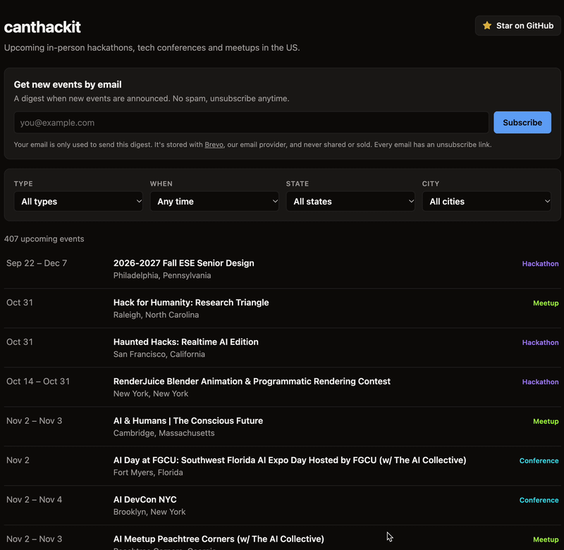

<div align="center">

# Can't Hack It

**In-person hackathons, tech conferences and meetups across the US, in one place.**<br>
Checked every day. Emailed to you only when something new shows up.

### [→ Browse upcoming events](https://mido4499.github.io/canthackit/)

[Get the email digest](https://mido4499.github.io/canthackit/#subscribe) ·
[Contribute](CONTRIBUTING.md) ·
[How it works](#how-it-works)

[](https://mido4499.github.io/canthackit/)
[](https://github.com/mido4499/canthackit/actions/workflows/update-events.yml)
[](https://github.com/mido4499/canthackit/actions/workflows/ci.yml)
[](LICENSE)

<a href="https://mido4499.github.io/canthackit/"></a>

⭐ **If Can't Hack It helps you find an event, please [star this repo](https://github.com/mido4499/canthackit).**<br>
It's free, takes one click, and it's how other students and job seekers discover it.

</div>

---

## 📅 Upcoming events

<!-- upcoming-events:start -->
**363 upcoming events**: 76 hackathons, 154 conferences and 133 meetups. [Browse and filter all of them →](https://mido4499.github.io/canthackit/)

<sub>Updated automatically every day. Last update: November 14, 2026.</sub>

### 🆕 Just announced (62 this week)

| Event | When | Where | Type |
|---|---|---|---|
| [UnlockedHacks](https://unlockedhacks.org/) | Nov 14 | Portland, Oregon | Hackathon |
| [Earth Hacks 2027](https://earthhacks.dev) | Jan 23⁠–⁠24 | San Francisco, California | Hackathon |
| [Arc of AI 2027](https://www.arcofai.com/) | Apr 19⁠–⁠22 | Austin, TX | Conference |
| [The Next Frontier \| Launchpad](https://luma.com/xe05zhe1) | Nov 13⁠–⁠14 | Virginia Beach, Virginia | Meetup |
| [AI Walk n Talk - Sandy Springs (w/ The AI Collective)](https://luma.com/aic-at-11-14) | Nov 14 | Atlanta, Georgia | Meetup |
| [The Next Frontier \| Mission Control](https://luma.com/rcgp5z5x) | Nov 14 | Virginia Beach, Virginia | Meetup |
| [Claude for Wealth Managers & Family Offices](https://luma.com/mg9bwdwr) | Nov 17 | San Francisco, California | Meetup |
| [Coffee with Enhans at Microsoft Ignite](https://luma.com/sw2385hk) | Nov 17 | San Francisco, California | Meetup |
| [IT Leaders Happy Hour \| San Francisco \| MS Ignite](https://luma.com/2i0glbm4) | Nov 17 | San Francisco, California | Meetup |
| [Unwind Before Ignite: An Exclusive MSP Happy Hour](https://luma.com/zbltcy54) | Nov 17 | San Francisco, California | Meetup |

### 🏁 Next hackathons

| Event | When | Where |
|---|---|---|
| [Boston \| AI Healthcare Hackathon with Claude Build Day](https://luma.com/claude-hovn) | Nov 14 | Boston, Massachusetts |
| [Central Hacks](https://central-hacks.devpost.com/) | Nov 14⁠–⁠15 | Mount Pleasant, Michigan |
| [Code/Clash](https://code-clash.devpost.com/) | Nov 14 | Towson, Maryland |
| [Hack The Nest](https://hackthenest.tech/) | Nov 14⁠–⁠15 | Ypsilanti, Michigan |
| [Hack the Harvest](https://hack-the-harvest.devpost.com/) | Nov 14⁠–⁠15 | Sacramento, California |
| [HackUTA](https://hackuta.com/) | Nov 14⁠–⁠15 | Arlington, Texas |
| [Haven Asbury Park Game Jam - High School](https://haven-asbury-park.devpost.com/) | Nov 14 | Shrewsbury, New Jersey |
| [Haven Richmond](https://haven-richmond.devpost.com/) | Nov 14⁠–⁠15 | Richmond, Virginia |
| [Haven Seattle](https://haven-seattle.devpost.com/) | Nov 14⁠–⁠15 | Seattle, Washington |
| [OCSEFhacks](https://ocsefhacks.org/) | Nov 14⁠–⁠15 | Westminster, California |
<!-- upcoming-events:end -->

## 📬 Get new events by email

Get a digest of newly announced events, at most once a day and only when there's news.
Double opt-in, and every email has a one-click unsubscribe.

<a href="https://mido4499.github.io/canthackit/#subscribe"></a>

## Built for you if you're…

- 🎓 **A tech undergrad or grad student** hunting for hackathons to build projects, win
  prizes and get noticed by sponsors.
- 💼 **Looking for a tech job** and want to meet engineers, founders and recruiters in person.

No more checking ten websites. Can't Hack It checks them for you.

## What you get

- 🗺️ **[A live events page](https://mido4499.github.io/canthackit/)** listing every upcoming
  event, filterable by type, state, city and date.
- 📬 **[An email digest](https://mido4499.github.io/canthackit/#subscribe)** with only the
  events announced since your last email.

**How often:** new events are fetched every morning around 13:00 UTC (8–9 AM Eastern). You get an
email at most once a day, and only when there's news: once 10 new events have piled up, or
a week after the first new one, whichever comes first. Unsubscribe from any email in one
click.

Only in-person events in the US are included. Online-only events are left out on purpose.

## Where the events come from

| Source | What it adds |
|---|---|
| [MLH](https://www.mlh.com/seasons) | The official student hackathon season |
| [Devpost](https://devpost.com/hackathons) | Hackathons of every size, including company-run ones |
| [Hack Club](https://hackathons.hackclub.com) | Hackathons, mostly for high schoolers |
| [confs.tech](https://github.com/tech-conferences/conference-data) | Developer conferences (open dataset) |
| [developers.events](https://github.com/scraly/developers-conferences-agenda) | Developer conferences (open dataset) |
| [Luma](https://luma.com) | Meetups, hack nights and tech weeks from [followed calendars](config.toml), plus the ones Luma features under Tech and AI |
| [Eventbrite](https://www.eventbrite.com) | Events from chosen organizers (off until organizers are added to [`config.toml`](config.toml)) |

When the same event is listed on several sites, it shows up once.

Know a source that's missing? [Adding one](CONTRIBUTING.md#adding-a-new-source) takes a
single Python file.

## How it works

```
 MLH · Devpost · Hack Club · confs.tech · developers.events · Luma · Eventbrite
                                   │
                                   ▼
        canthackit/sources/   each returns US in-person events in one shared format
                                   │
                                   ▼
        canthackit/dedupe.py  merges the same event listed on several sites
                                   │
                                   ▼
        data/events.json      every upcoming event, committed back to this repo
                 │                                   │
                 ▼                                   ▼
        site/ → GitHub Pages                Brevo email digest
        (the events page)                   (new events only)
```

A GitHub Actions job runs this every day at 13:00 UTC. The repo is the database, so there are
no servers to run or pay for. New events are batched into a digest ([how often](#what-you-get))
so you get a useful email instead of a daily trickle.

## Contributing

Contributions are very welcome, and many don't need much code. Some of the most useful ones:

- **Follow a new Luma calendar** by adding one line to [`config.toml`](config.toml).
- **Add a source** for a site that lists hackathons or conferences.
- **Tackle a [known limitation](CONTRIBUTING.md#known-limitations)**, like messy locations in
  the email or events filed under the wrong type.

👉 **[CONTRIBUTING.md](CONTRIBUTING.md)** walks you through forking, running it locally
(no accounts or API keys needed) and opening your first pull request.

## Run your own copy

<details>
<summary>Want alerts for a different focus, or to send them to your own group? Here's how to set up your own instance.</summary>

<br>

1. **Fork this repo**, and keep it public, since free GitHub Pages needs that.
2. **Create a free [Brevo](https://www.brevo.com) account** (300 emails a day). Then:
   - Add and verify a sender under **Senders, Domains & Dedicated IPs**. A custom domain you
     authenticate there (DKIM and DMARC) keeps the digest out of spam far better than a Gmail
     address.
   - Create an API key under **SMTP & API → API Keys**.
   - Fill in your organization's name and postal address under **Settings → Company details**.
     Brevo puts them in every campaign's footer, as anti-spam law requires.
   - Create a list for subscribers under **Contacts → Lists**, and note its ID.
   - Create a subscription form for that list under **Contacts → Forms**, with double opt-in
     on, and put its `action` URL in the subscribe form in [`site/index.html`](site/index.html).
3. **In your fork, go to Settings → Secrets and variables → Actions.**

   | Secrets tab | Example |
   |---|---|
   | `BREVO_API_KEY` | `xkeysib-...` |
   | `EVENTBRITE_TOKEN` (optional) | your [Eventbrite private token](https://www.eventbrite.com/platform/api-keys) |

   | Variables tab | Example / default |
   |---|---|
   | `EMAIL_FROM` (required) | `Can't Hack It <alerts@yourdomain.com>`, your verified sender |
   | `BREVO_LIST_ID` (required) | `2`, your subscriber list |
   | `BATCH_SIZE` | `10` |
   | `MAX_WAIT_DAYS` | `7` |

4. **Under Settings → Pages**, set the source to **GitHub Actions**.
5. **Run Actions → Update events → Run workflow.** The first run stores existing events
   without emailing, so subscribers only hear about events announced after that. When it
   finishes, *Publish site* puts the page at `https://<you>.github.io/<repo>/`, and the
   digest links to it automatically.

</details>

## Show your support

If you found a hackathon, a conference or your next job through Can't Hack It,
**[give it a ⭐ on GitHub](https://github.com/mido4499/canthackit)** and share
[the events page](https://mido4499.github.io/canthackit/) with your friends, classmates or
your school's CS club. Every star helps more people find it.

## License

[MIT](LICENSE). Use it, fork it, make it yours.
